<p align="center">
  <a href="docs/video/carecircle-motion.mp4">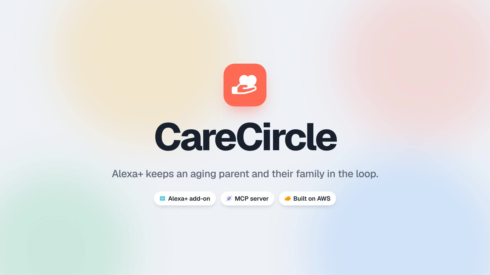</a>
</p>

<h1 align="center">CareCircle</h1>

<p align="center"><b>An Alexa+ add-on that keeps an aging parent and their family in the loop.</b></p>

<p align="center">
  <a href="docs/video/carecircle-motion.mp4">▶ Motion demo (66 s)</a> ·
  <a href="docs/video/app-walkthrough.mp4">▶ Real app walkthrough (46 s)</a> ·
  <a href="docs/DEVPOST.md">Devpost write-up</a> ·
  <a href="#architecture">Architecture</a>
</p>

Mom says *"had my oatmeal and the little white pill"* to Alexa. Her daughter, three hours away, asks *"how's Mom today?"* and hears a short, natural answer. If Mom hasn't checked in by 10 AM, or a dose goes unconfirmed, the family gets a text. On Friday there's a one-page summary ready for the doctor.

CareCircle is an [MCP](https://modelcontextprotocol.io) server (spec **2025-11-25**, **Streamable HTTP**) built with the official TypeScript MCP SDK. It runs on your laptop with no cloud account, and deploys to AWS (Lambda, DynamoDB, EventBridge, SNS, Bedrock) with one command when you want it to.

Built for the Amazon Developer Hackathon 2026, Alexa+ track.

<p align="center">
  <a href="docs/video/carecircle-motion.mp4">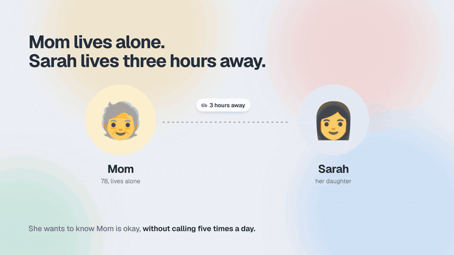</a>
</p>

## How it works, in six frames

Stills from the [motion demo](docs/video/carecircle-motion.mp4).

| | |
|---|---|
| 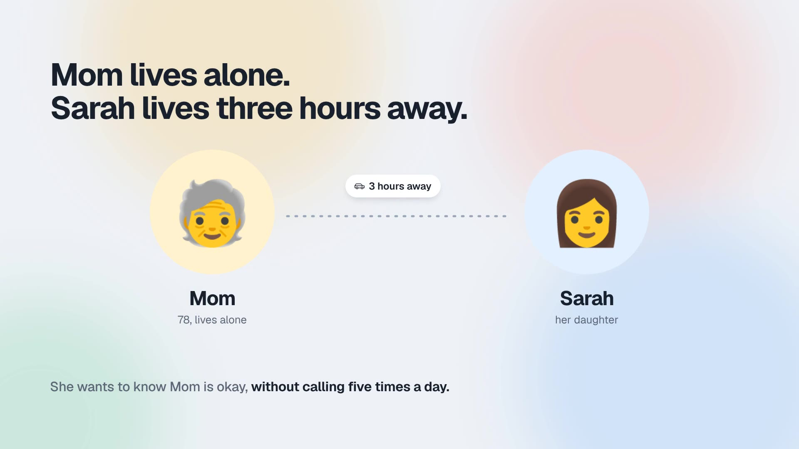 | 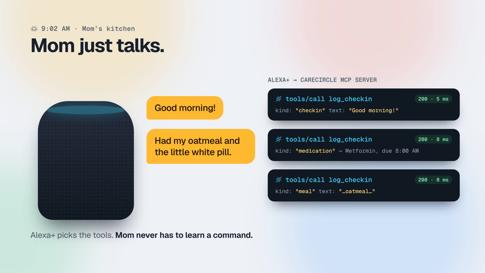 |
| **The problem.** Mom lives alone. Sarah, three hours away, wants to know she's okay without calling five times a day. | **Mom just talks.** "Good morning!" and "had my oatmeal and the little white pill" become three `log_checkin` calls. Alexa+ picks the tools, so there are no commands to learn. |
| 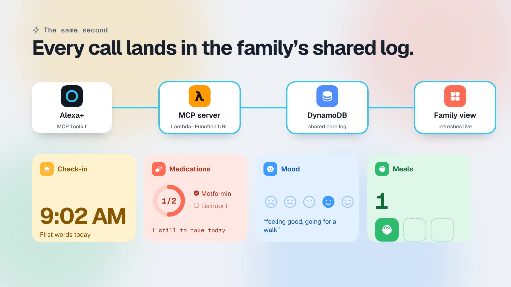 | 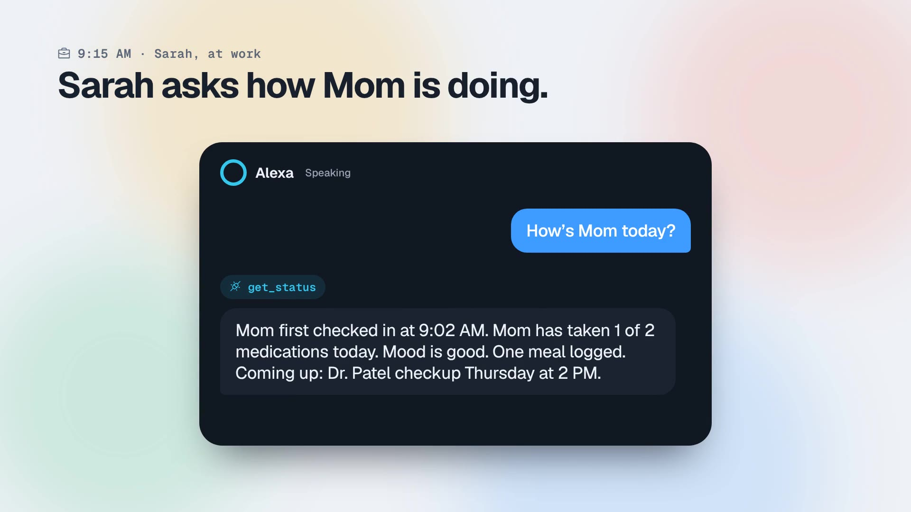 |
| **One shared log.** Each call goes through the MCP server on Lambda into DynamoDB, and the family dashboard updates within seconds. | **The family asks.** "How's Mom today?" calls `get_status` and gets one natural paragraph: check-in time, doses, mood, meals, what's next. |
| 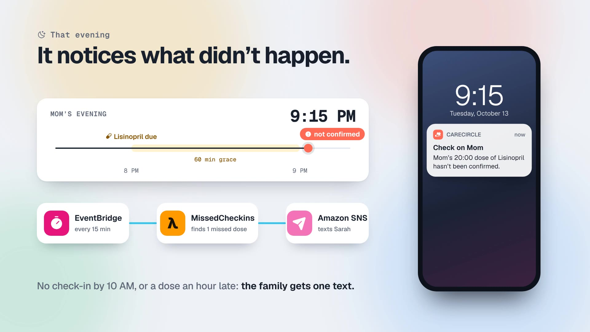 | 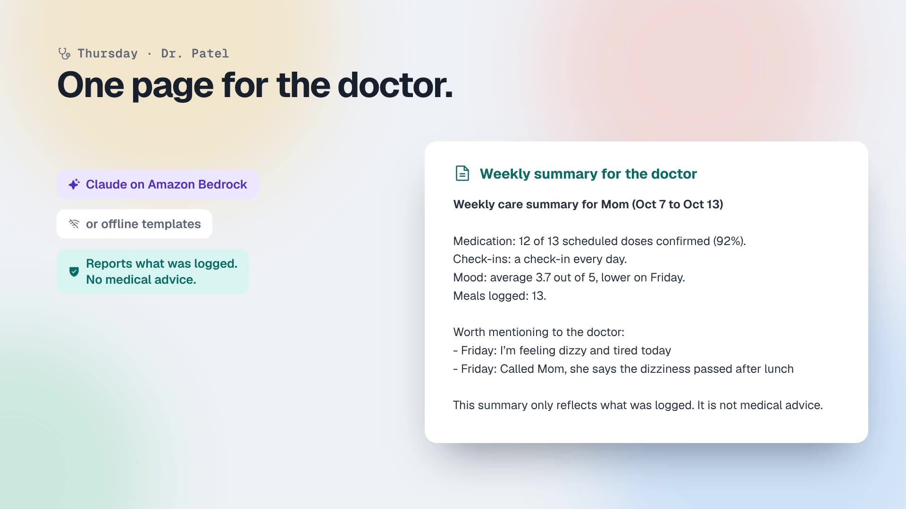 |
| **It notices what didn't happen.** No check-in by 10 AM, or a dose more than an hour late, and EventBridge, the MissedCheckins Lambda and SNS text the family once. | **One page for the doctor.** A week of logs as a printable summary, written by Claude on Amazon Bedrock or by offline templates. No medical advice. |

## In the real app

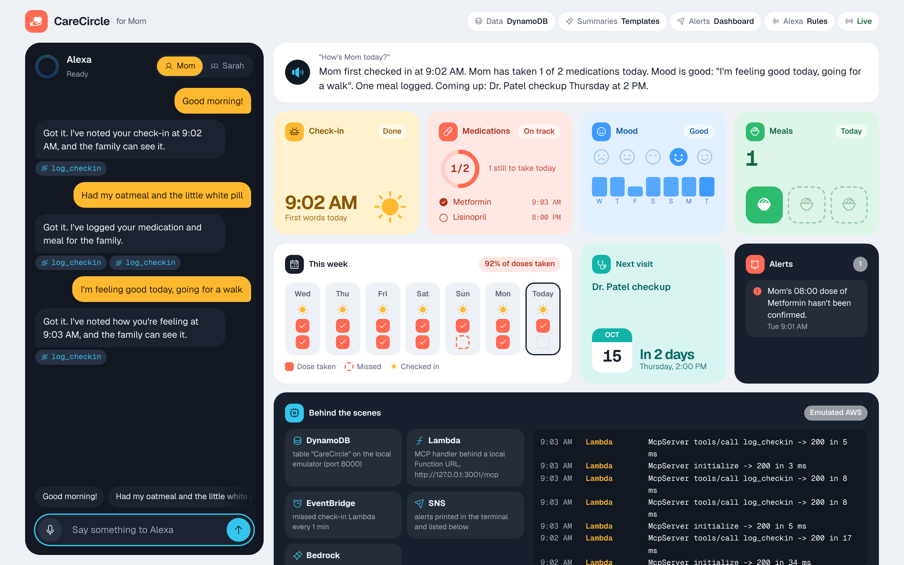

**The demo app.** A simulated Alexa on the left calls the real MCP server; the family dashboard on the right shows check-in, medications, mood, meals, the week, the next visit, alerts and a live feed of what AWS is doing.

| | |
|---|---|
| 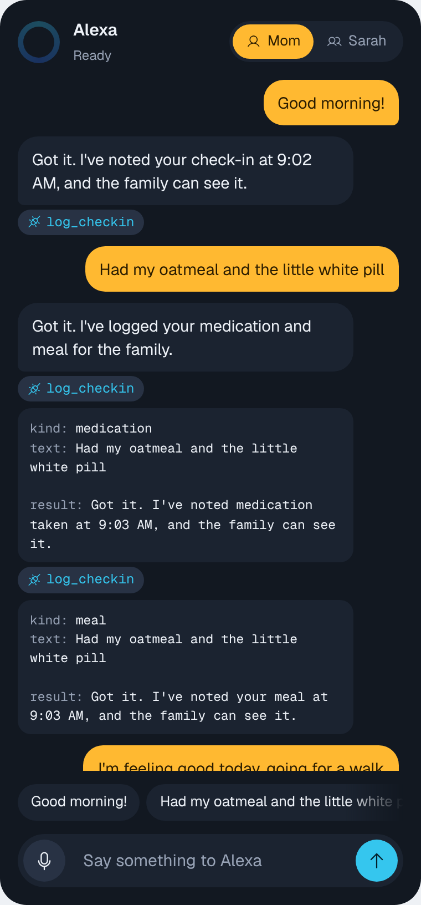 | 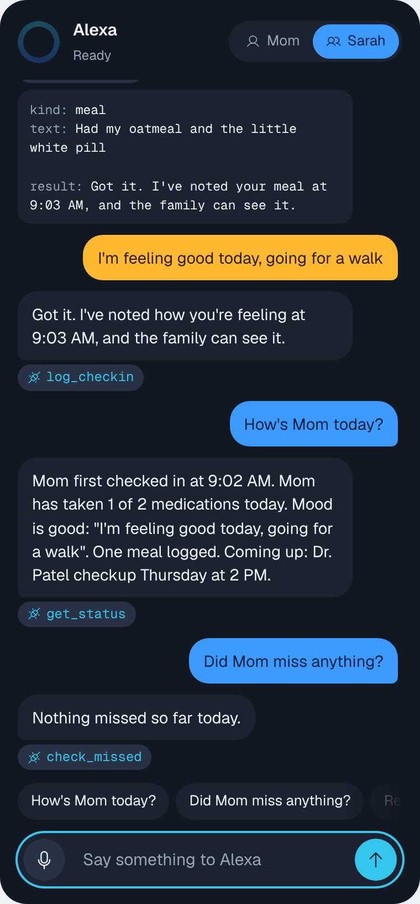 |
| **Mom just talks.** One sentence becomes two `log_checkin` calls (a dose and a meal). Each reply shows the MCP calls it made, with arguments and results. | **The family asks.** Sarah switches speaker and asks "How's Mom today?" (`get_status`) and "Did Mom miss anything?" (`check_missed`). |

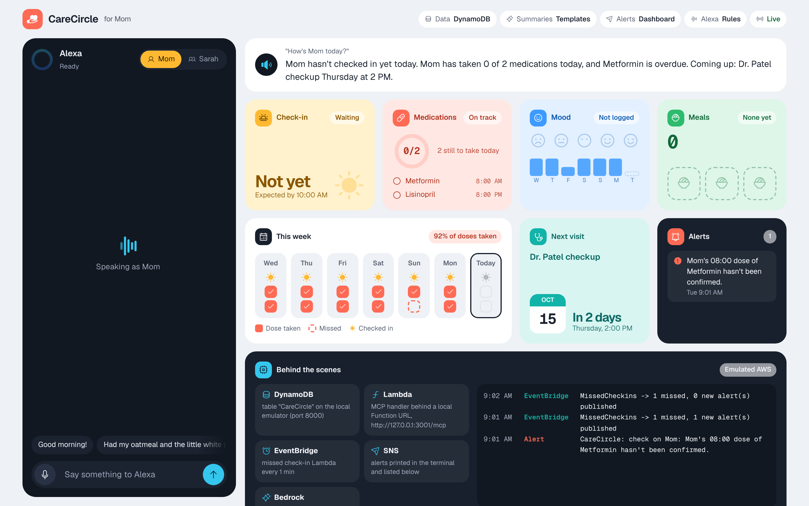

**Before Mom says a word.** At 9:01 AM the scheduled check found Metformin (due 8:00) unconfirmed, and the alert is already on the family's list.

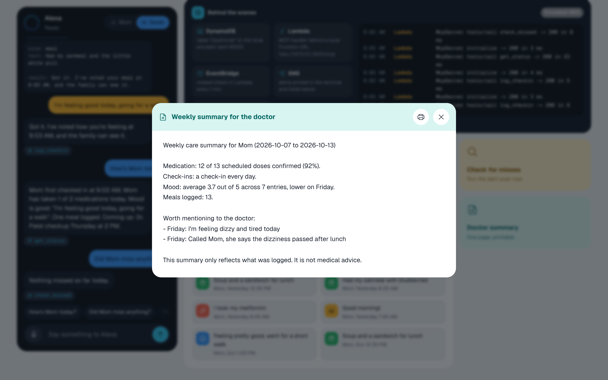

**One page for the doctor.** A week of logs as a printable summary: dose adherence, check-ins, mood trend and anything worth raising. Template sentences offline, or Claude on Amazon Bedrock.

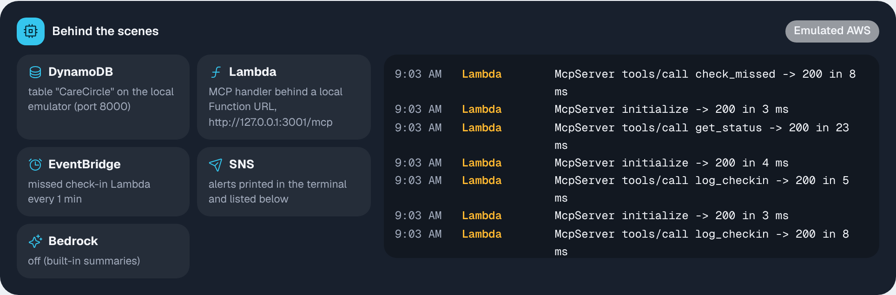

**Behind the scenes.** Under `npm run aws:local` every Lambda invocation, scheduled run and SNS alert shows up live.

The [full page](docs/images/screenshots/07-full-page.png) also has the weekly dose grid, mood history, next appointment and a filterable activity feed.

## Architecture

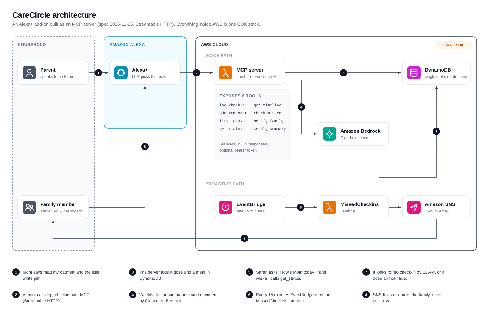

A turn, end to end:

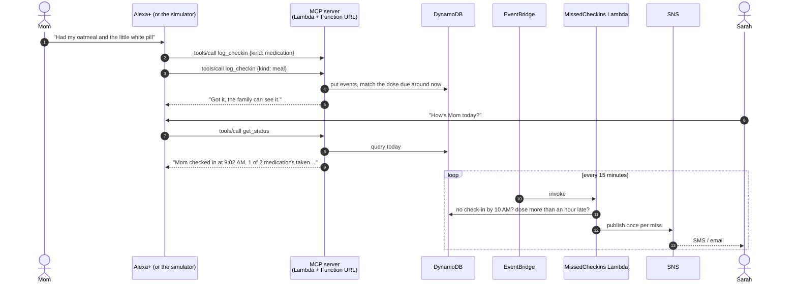

No AWS account? `npm run aws:local` runs the same handlers against local emulators:

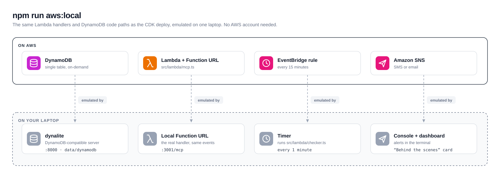

## What it does

| Who | Says | Tool |
|---|---|---|
| Parent | "Good morning", "I took my pills", "I'm feeling tired today" | `log_checkin` |
| Parent or family | "Remind me about the doctor Thursday at 2" | `add_reminder` |
| Parent | "What do I still need to take today?" | `list_today` |
| Family | "How's Mom today?" | `get_status` |
| Family | "What happened this week?" | `get_timeline` |
| Anyone, or the scheduler | "Did Mom miss anything?" | `check_missed` |
| Parent | "Tell the kids I'm going to bed early" | `notify_family` |
| Family | "Give me the weekly summary for the doctor" | `weekly_summary` |

Behind the tools:

- **Missed check-in alerts.** No check-in by `CHECKIN_DEADLINE`, or a dose not confirmed within `DOSE_GRACE_MINUTES`, alerts the family once (by SNS text or email on AWS, in the log locally).
- **Natural dose matching.** "Took my metformin" marks that medication. A generic "took my pills" marks the doses due around then, so the morning pills don't cover the evening ones.
- **Summaries.** Template sentences offline, or Claude on Amazon Bedrock when `SUMMARIZER=bedrock`. If Bedrock fails it falls back to the template.
- **No medical advice.** It only reports what was logged.

## Try it live

[](https://render.com/deploy?repo=https://github.com/Nicolas-Arsenault/CareCircle)

[`render.yaml`](render.yaml) runs the whole demo (MCP endpoint, simulated Alexa and family page) as one Node process on Render's free plan. It seeds a demo week on every start, and the free instance sleeps when idle, so the demo resets itself between visitors. The first visit after a sleep takes about a minute to wake up.

**What's real and what's simulated.** Alexa+ add-ons can only be tested on a real Echo once Amazon grants toolkit access, so the left panel plays Alexa+: it turns what you say or type into tool calls. Everything after that is the real add-on: each turn is a real MCP request to this server, the calls show under every answer, and the dashboard updates live. "Start the 1-minute demo" walks through the whole loop. Voice input is optional (Chrome, Edge and Safari); typing and the phrase chips work everywhere.

By default the simulated Alexa uses offline phrase rules, which handle the demo phrases and close variations. To let it understand anything a visitor types, add an `ANTHROPIC_API_KEY` environment variable on Render: Claude then picks the tools, the way Alexa+'s model does, and the rules take over if the API is unreachable.

## Run it locally (no AWS needed)

Requires Node.js 20 or newer.

```bash
npm install
npm run seed     # optional: a believable week of history for demos
npm run dev
```

Then open <http://127.0.0.1:3000>. You get:

- **A simulated Alexa** on the left, styled like an Echo. Pick who's talking (Mom or her daughter Sarah), then speak (Chrome, Edge or Safari), type, or tap a suggested phrase. The light ring shows when it is listening, thinking or speaking. It calls the CareCircle MCP server over real Streamable HTTP, the same way Alexa+ does; each reply lists the tools it called, and you can expand one to see the arguments and the result.
- **The family view** on the right, as a grid of colour-coded widgets (each kind of data keeps its colour everywhere: medication coral, check-in yellow, mood blue, meals green, appointments teal):
  - what Alexa would answer to "How's Mom today?";
  - **Check-in**: time of the first thing Mom said today, or when it's expected;
  - **Medications**: a progress ring plus each dose (taken, due, or overdue);
  - **Mood**: today's mood on a five-face scale and a 7-day mood bar chart;
  - **Meals**: meals logged today;
  - **This week**: one column per day with a square per scheduled dose (taken or missed), whether Mom checked in, and the week's dose percentage;
  - **Next visit**: a countdown to the next appointment;
  - **Alerts**: what was sent to the family;
  - **Activity**: the latest logged events, filterable by type.
  - **Behind the scenes**: which backends are in use (or, under `npm run aws:local`, each emulated AWS service) and a live log of Lambda calls, scheduled runs and alerts from `GET /api/activity`.

  It refreshes every 5 seconds and outlines activity that just arrived.
- **Actions:** "Check for misses" runs the missed check-in scan on demand; "Doctor summary" opens the weekly summary in a printable dialog.
- **Page API:** besides the endpoints above, the page polls `GET /api/week` (doses per day, events and missed check-in days for the last 7 days; no AI call, so it stays cheap with `SUMMARIZER=bedrock`).
- **The top bar** shows which backends are active (data store, summaries, alerts, how Alexa understands speech), read from `GET /api/config`.

The page always uses its light theme (it ignores the system dark-mode setting) and honours reduced-motion. Fonts (Geist) and icons (Phosphor) are served from local npm packages under `/vendor/*`, so the demo needs no internet connection.

By default the simulator understands speech with simple offline rules (`src/alexa/rules.ts`). Set `ALEXA_BRAIN=bedrock` to let Claude on Bedrock pick the tools instead, or set `ANTHROPIC_API_KEY` to use Claude through the Anthropic API.

### Emulated AWS, still on your machine

If you have no AWS account, or one whose plan blocks these services, run the AWS version of the app locally:

```bash
npm run aws:local            # add -- --seed to reset the demo data
```

This runs the same code paths as the real deployment, with nothing to install beyond `npm install`:

| AWS service | Emulated by |
|---|---|
| DynamoDB | [dynalite](https://github.com/architect/dynalite), a DynamoDB-compatible server (data in `data/dynamodb`) |
| Lambda + Function URL | the real handler in `src/lambda/mcp.ts`, behind a local Function URL on port 3001 |
| EventBridge | the real `src/lambda/checker.ts`, run every minute |
| SNS | alerts printed in the terminal and listed on the dashboard |

The simulated Alexa goes through the emulated Function URL, and the dashboard's **Behind the scenes** card shows each Lambda invocation, scheduled run and alert as it happens.

### Talk to the MCP server directly

The endpoint is `http://127.0.0.1:3000/mcp`. With [MCP Inspector](https://github.com/modelcontextprotocol/inspector):

```bash
npm run inspector
# Transport: Streamable HTTP, URL: http://127.0.0.1:3000/mcp
```

### Tests

```bash
npm test         # care logic, phrase routing, and a full MCP round trip over HTTP
npm run typecheck
```

## Configuration

Everything is an environment variable with a working default. Copy `.env.example` to `.env` to change them.

| Variable | Default | |
|---|---|---|
| `PARENT_NAME` | `Mom` | How the parent is named in answers |
| `CARE_TIMEZONE` | `America/Toronto` | The parent's time zone |
| `CHECKIN_DEADLINE` | `10:00` | Alert if there's no check-in by then |
| `DOSE_GRACE_MINUTES` | `60` | How late a dose can be before alerting |
| `STORE` | `file` | `file` (`data/carecircle.json`), `memory` or `dynamodb` |
| `SUMMARIZER` | `template` | `template` or `bedrock` |
| `ALEXA_BRAIN` | `rules` (`claude` when `ANTHROPIC_API_KEY` is set) | How the simulator understands speech: `rules`, `bedrock` or `claude` |
| `ANTHROPIC_MODEL` | `claude-haiku-5-5` | Model for `ALEXA_BRAIN=claude` |
| `BEDROCK_MODEL_ID` | `anthropic.claude-opus-5-5` | Any Claude model on Bedrock |
| `NOTIFIER` | `console` | `console` or `sns` (needs `SNS_TOPIC_ARN`) |
| `MCP_AUTH_TOKEN` | empty | If set, `/mcp` requires `Authorization: Bearer <token>` |

## Deploy to AWS (optional)

The hackathon doesn't provide AWS credits to participants, so everything above works without AWS. When you do want it hosted, the CDK stack in `infra/` creates:

- **DynamoDB** table (on-demand, single-table design)
- **Lambda** running the MCP server behind a **Function URL** (stateless Streamable HTTP, no adapter layer)
- **EventBridge** schedule running the missed check-in Lambda every 15 minutes
- **SNS** topic that texts or emails the family
- **Bedrock** permissions, if you turn summaries on

At hackathon traffic this fits inside the AWS free tier, apart from Bedrock calls if enabled.

```bash
npm install                      # in the repo root
cd infra && npm install
npx cdk bootstrap                # once per account and region
npx cdk deploy \
  -c parentName=Mom -c timeZone=America/Toronto \
  -c alertEmail=you@example.com \
  -c mcpAuthToken=$(openssl rand -hex 24) \
  -c bedrock=true                # optional
```

The `McpUrl` output is the endpoint to give Alexa+ or MCP Inspector. `npx cdk destroy` removes everything.

## Connecting to real Alexa+

See [docs/alexa-plus.md](docs/alexa-plus.md). In short: Alexa+ connects to MCP servers through its **MCP Toolkit** (`alexa-ai` CLI, developer console, web simulator), and needs a public HTTPS URL, OAuth 2.1, and responses under 500 ms. Access to the toolkit currently goes through Amazon, so the simulated Alexa in this repo is the default demo path.

## Project layout

```
src/
  care.ts            all CareCircle behaviour (check-ins, reminders, misses, summaries)
  mcp.ts             the MCP server and its 8 tools
  server.ts          local HTTP server: /mcp, the family page API, the simulator
  alexa/             simulated Alexa: offline phrase rules, or Claude on Bedrock, calling /mcp
  store/             memory, JSON file and DynamoDB storage
  ai/                template and Bedrock summaries
  notify/            console and SNS alerts
  lambda/            AWS Lambda entry points (MCP endpoint, missed check-in job)
web/index.html       simulated Alexa + family view (single file, no build step)
docs/                Alexa+ notes, Devpost write-up, diagrams, screenshots, demo videos
infra/               AWS CDK stack
test/                node:test suites
```

## Demo media

Everything under `docs/images` and `docs/video` is generated from this repo:

- **Screenshots and the walkthrough video** come from the real app under `npm run aws:local -- --seed`, driven by Playwright.
- **The motion demo** is [`docs/video/motion.html`](docs/video/motion.html), a single page you can open in a browser (after `npm install`) to watch it play live. `node docs/video/render.mjs` renders it frame by frame to MP4 (needs Playwright and ffmpeg; see the top of the script).
- **Diagrams** are hand-written SVG in [`docs/images`](docs/images), with PNG copies for places that don't take SVG, like Devpost.

## Privacy

CareCircle only stores what the parent or a family member chose to log. It does not diagnose or give medical advice, and its summaries say so. For anything beyond a demo, add per-family-member consent and OAuth (see [docs/alexa-plus.md](docs/alexa-plus.md)), and switch the DynamoDB table's removal policy to `RETAIN`.

## License

[MIT](LICENSE)
